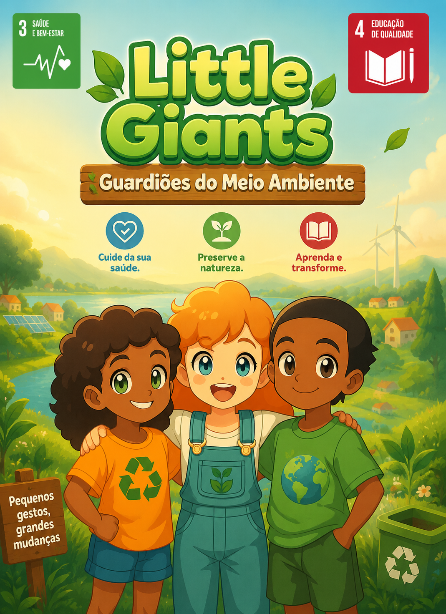
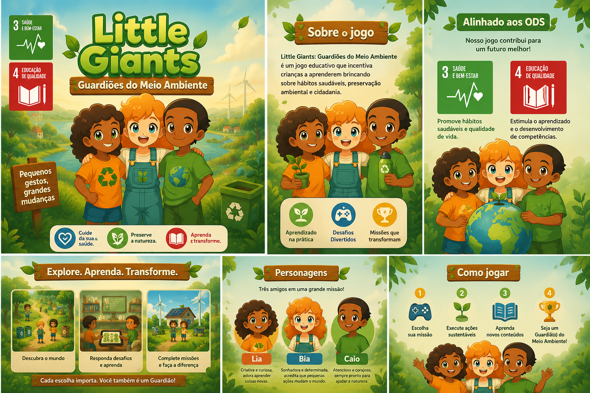
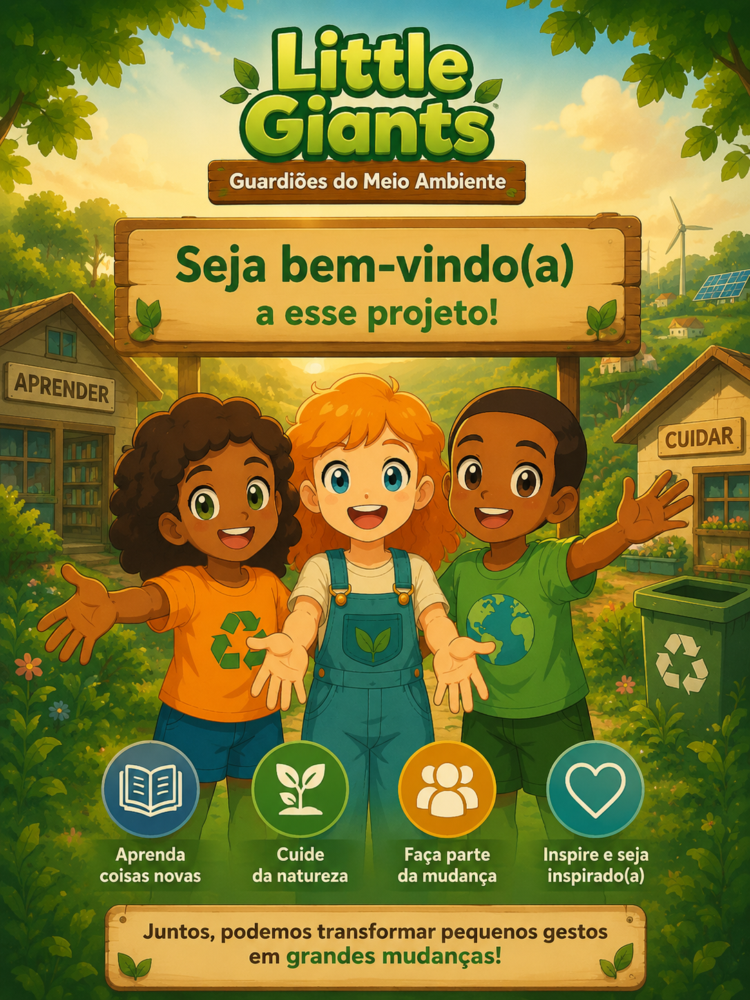
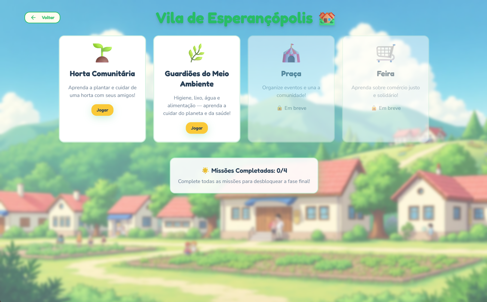
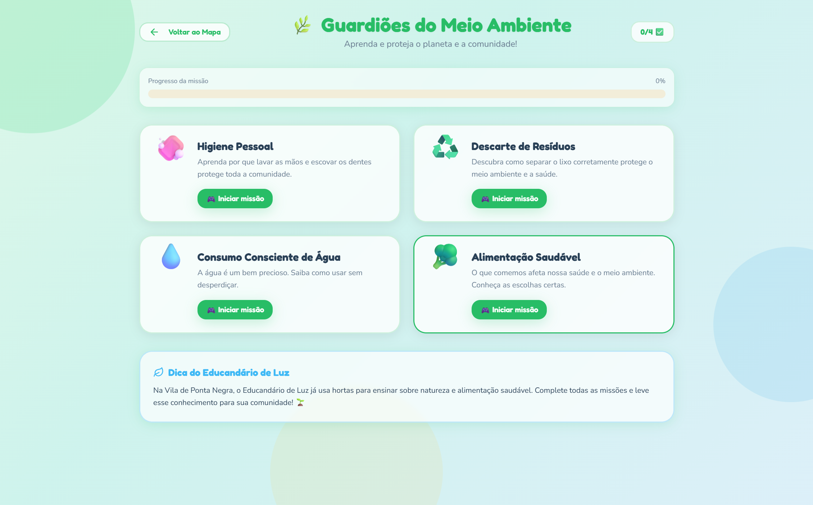
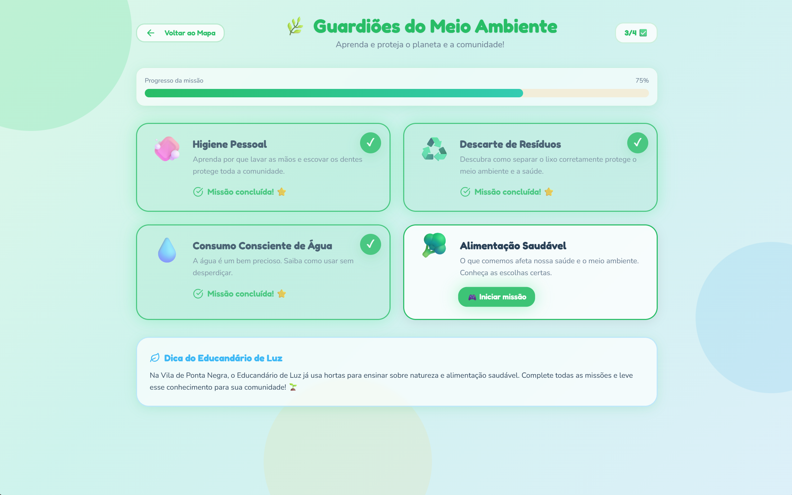
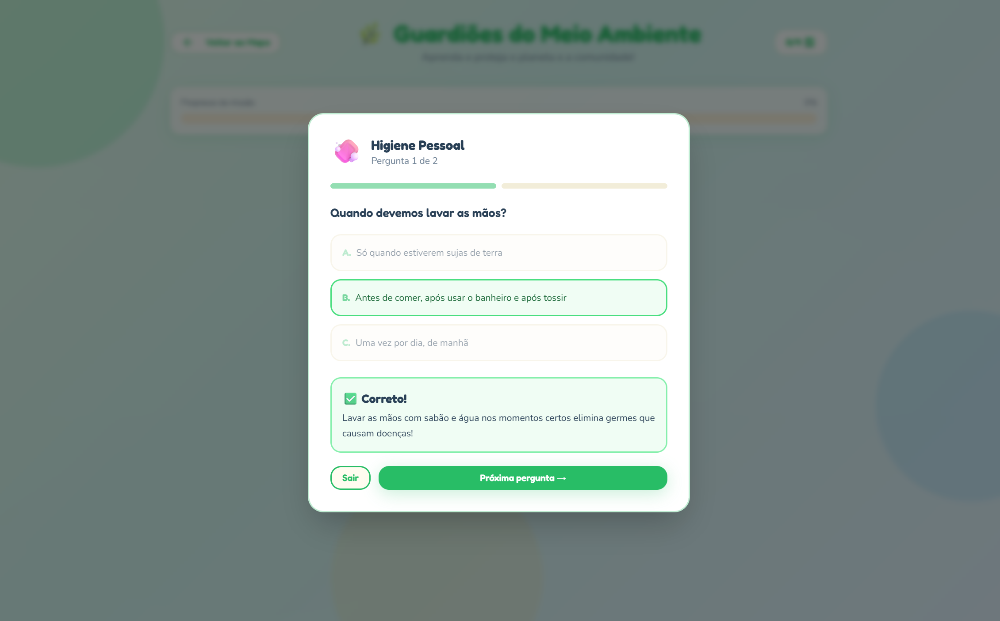
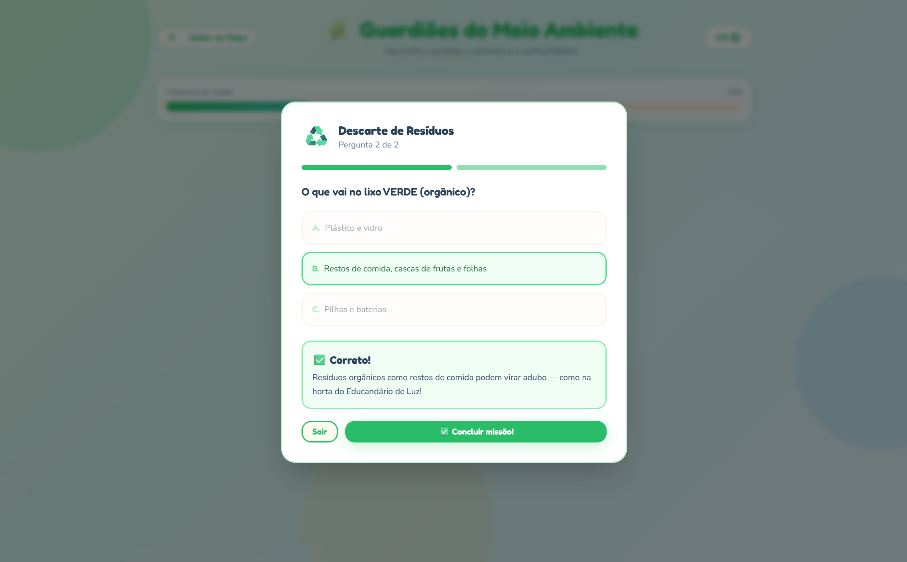
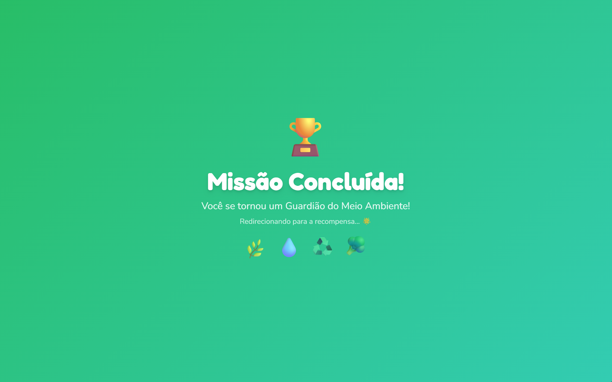
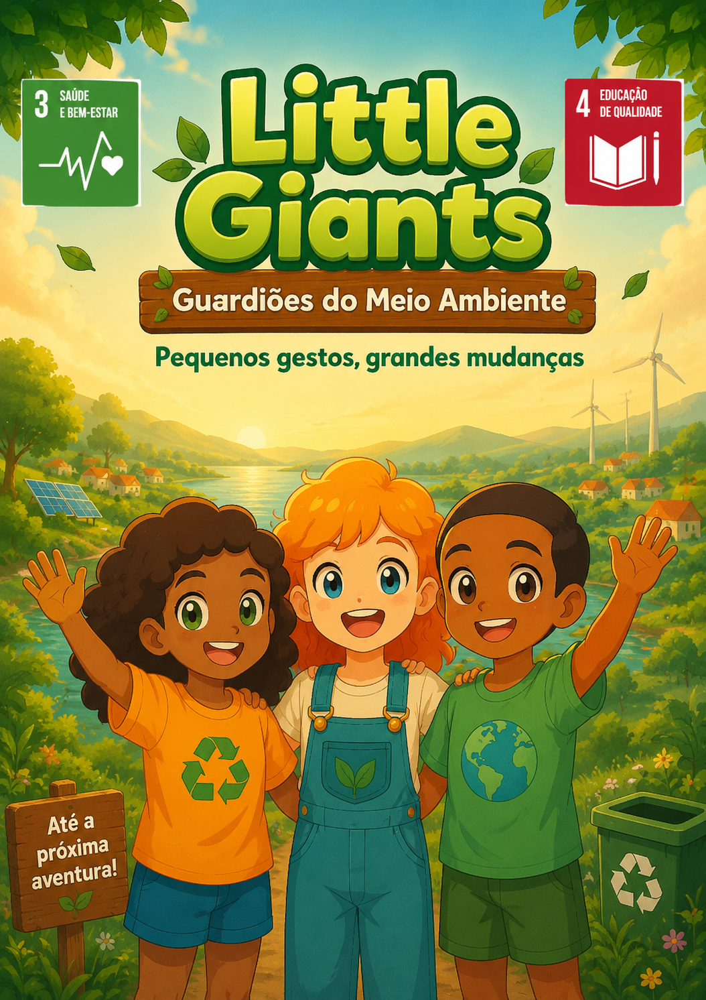

<div align="center">



# 🕹️ Little Giants: Guardiões do Meio Ambiente

**Pequenos gestos, grandes mudanças.**

[](https://brasil.un.org/pt-br/sdgs/3)
[](https://brasil.un.org/pt-br/sdgs/4)
[]()
[](https://react.dev)

</div>

---

## 📖 Sobre o Projeto

O **Little Giants: Guardiões do Meio Ambiente** é um jogo educativo e interativo criado para incentivar crianças a aprenderem brincando sobre **hábitos saudáveis, preservação ambiental e cidadania**.

Por meio de missões temáticas, desafios e personagens cativantes, o jogo transforma pequenos gestos cotidianos em grandes aprendizados — conectando educação, saúde e sustentabilidade de forma lúdica.

Inspirado na realidade da **Vila de Ponta Negra (Natal/RN)**, desenvolvido em parceria com o **Educandário de Luz – Projeto AMAR**.

---

## 🎯 Objetivo

- 🌱 Promover **hábitos sustentáveis** e cuidado com o meio ambiente
- 💚 Estimular **saúde e bem-estar** desde a infância
- 📚 Reforçar **aprendizado ativo** por meio da gamificação
- 🤝 Desenvolver **empatia, cooperação e cidadania**

---

## 👾 Personagens

| Personagem | Descrição |
|------------|-----------|
| 🟠 **Lia** | Criativa e curiosa, adora aprender coisas novas |
| 🔵 **Bia** | Sonhadora e determinada, acredita que pequenas ações mudam o mundo |
| 🟢 **Caio** | Atencioso e corajoso, sempre pronto para ajudar a natureza |

---

## 🖼️ Prévia do Jogo

<div align="center">

### Apresentação


### Tela de Boas-vindas


### Mapa - Vila de Esperançópolis


### Missões disponíveis
| Seleção de Missões | Missões em Progresso |
|---|---|
|  |  |

### Quiz das Missões
| Pergunta | Resposta |
|---|---|
|  |  |

### Missão Concluída!


### Tela de Despedida


</div>

---

## 🕹️ Como Jogar

```
1. Escolha sua missão na Vila de Esperançópolis
2. Execute ações sustentáveis
3. Aprenda novos conteúdos respondendo quizzes
4. Seja um(a) Guardião(ã) do Meio Ambiente!
```

---

## 🗺️ Fases do Jogo

| Fase | Tema | Status |
|------|------|--------|
| 🌱 **Horta Comunitária** | Aprenda a plantar e cuidar com seus amigos | ✅ Disponível |
| 🌿 **Guardiões do Meio Ambiente** | Higiene, lixo, água e alimentação | ✅ Disponível |
| 🎪 **Praça** | Organize eventos e una a comunidade | 🔒 Em breve |
| 🛒 **Feira** | Aprenda sobre comércio justo e solidário | 🔒 Em breve |

### Missões — Guardiões do Meio Ambiente

| Missão | Tema | Status |
|--------|------|--------|
| 🧼 Higiene Pessoal | Lavar as mãos e escovar os dentes protege toda a comunidade | ✅ Disponível |
| ♻️ Descarte de Resíduos | Separar o lixo corretamente protege o meio ambiente e a saúde | ✅ Disponível |
| 💧 Consumo Consciente de Água | A água é um bem precioso — saiba como usar sem desperdiçar | ✅ Disponível |
| 🥦 Alimentação Saudável | O que comemos afeta nossa saúde e o meio ambiente | ✅ Disponível |

---

## 🌍 Alinhamento aos ODS

| ODS | Contribuição |
|-----|-------------|
| **3 – Saúde e Bem-Estar** | Promove hábitos saudáveis e qualidade de vida desde a infância |
| **4 – Educação de Qualidade** | Estimula o aprendizado ativo e o desenvolvimento de competências |

---

## 🧠 Impacto Educacional

Resultados obtidos durante os testes no **Educandário de Luz**:

| Indicador | Resultado | Descrição |
|-----------|-----------|-----------|
| 🎮 Engajamento infantil | **90%** | Participação ativa nas mecânicas do jogo |
| 👩‍🏫 Satisfação dos educadores | **100%** | Aceitação total durante a fase experimental |
| 💻 Apoio ao uso de tecnologia | **6/6 educadores** | Integração digital reconhecida como positiva |
| 📈 Desenvolvimento cognitivo | **Alto** | Melhora na atenção e envolvimento nas atividades |

---

## 💬 Feedback da Comunidade

> *"O jogo despertou o interesse das crianças e reforçou valores essenciais que trabalhamos diariamente."*
>
> — Educadora do Projeto AMAR

---

## 🧪 Tecnologias Utilizadas

- **React.js** — interface e lógica do jogo
- **JavaScript** — mecânicas e interatividade
- **Tailwind CSS** — estilização responsiva
- **Framer Motion** — animações e transições
- **Canva & Figma** — identidade visual e design
- **Excel** — análise de dados e métricas
- **PowerPoint** — relatórios e apresentações

---

## 🚀 Como Executar Localmente

```bash
# Clone o repositório
git clone https://github.com/reinaldo-matheus/little-giants-world.git

# Acesse a pasta
cd little-giants-world

# Instale as dependências
npm install

# Inicie o projeto
npm start
```

---

## 🗺️ Roadmap

- [x] Identidade visual — Little Giants: Guardiões do Meio Ambiente
- [x] Personagens: Lia, Bia e Caio
- [x] Mapa — Vila de Esperançópolis
- [x] Fase: Horta Comunitária
- [x] Fase: Guardiões do Meio Ambiente (4 missões completas)
- [ ] Fase: Praça — convivência e solidariedade
- [ ] Fase: Feira — empatia e consumo consciente
- [ ] Sistema de recompensas e badges
- [ ] Modo multiplayer cooperativo

---

## 🌱 Parceria Social

Desenvolvido em parceria com a **Escola Educandário de Luz – Projeto AMAR**, organização filantrópica com mais de 10 anos de impacto social na Vila de Ponta Negra, Natal/RN.

---

<div align="center">

**Juntos, podemos transformar pequenos gestos em grandes mudanças! 🌍**

Feito com 💚 por [Matheus Reinaldo](https://github.com/reinaldo-matheus)

</div>
